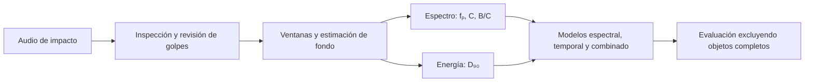

# Acoustic Material Classification

**Estudiar cómo suenan los objetos al golpearlos: frecuencias, distribución espectral y duración de su energía sonora.**

Proyecto experimental de acústica física para estudiar objetos
de **madera, vidrio, hierro y plástico rígido**. Combina procesamiento de señales,
control de calidad, trazabilidad de datos y comparación de modelos por objeto.

> **Estado:** piloto exploratorio de ocho objetos, dos por categoría. El proyecto
> documenta tanto los resultados como sus límites; todavía no es un identificador
> fiable de materiales para uso general.


**Empieza aquí:** [tutorial visual paso a paso](docs/tutorial_descriptores.md)
· [escuchar el golpe del ejemplo](examples/botella_vidrio/botella_golpe01.wav)
· [método de extracción](docs/metodo_descriptores.md)
· [evaluación inicial](resultados/modelos_piloto_v1/informe.md).

## La pregunta

¿Qué frecuencias destacan al golpear un objeto, cómo se reparte su potencia
y cuánto persiste la energía de su sonido? ¿Qué parte de esas variaciones se
repite en las categorías de material que estamos estudiando?

Medimos e interpretamos esas características acústicas. Después utilizamos
la clasificación de objetos no vistos como una prueba adicional de la información
que contienen; el modelo no sustituye la interpretación física del experimento.

El reto es separar indicios útiles del material de las variaciones de forma,
tamaño, apoyo, percutor y grabación. Se mantienen fuera del clasificador los
identificadores, el nombre del archivo, el participante y las dimensiones del objeto.

## Del audio a la predicción



| Característica | Interpretación | Unidad |
|---|---|---|
| Frecuencia prominente, fₚ | Máximo de potencia en la banda analizada | Hz |
| Centroide, C | Promedio de frecuencias ponderado por potencia | Hz |
| Ancho relativo, B/C | Dispersión espectral relativa al centroide | Adimensional |
| Duración energética, D₉₀ | Tiempo entre el 5 % y el 95 % de energía corregida | s |

Las tres características espectrales usan 100 ms y banda 100–20000 Hz.
La duración se calcula sobre una ventana temporal ajustada al retorno al fondo,
con corrección de potencia previa por bloques de 1 ms. Son medidas de la señal
bajo el montaje utilizado, no estimaciones directas de densidad, dureza o módulo elástico.

## Un cálculo que se puede inspeccionar

El tutorial utiliza un golpe real de una botella, con un recorte PCM de 0,8485 s
que incluye el fondo anterior. El resultado es:

```text
fₚ  = 2300 Hz
C   = 2998.7063 Hz
B/C = 0.880707
D₉₀ = 60.1147 ms
```

Las [gráficas del tutorial](docs/tutorial_descriptores.md) señalan el máximo del
espectro, explican los pesos del centroide y muestran los cruces de energía.
Incluye fórmulas, coordenadas de muestra, archivos CSV y verificación SHA-256.
El script utiliza las mismas funciones que el pipeline; no es una simulación.

## Resultados actuales

Se detectaron 42 candidatos. Tras revisión por escucha quedaron **37 golpes
aceptados y cinco excluidos**. D₉₀ no pudo estimarse en un golpe cuya cola no se
aisló; la comparación de modelos utiliza los mismos **36 golpes de ocho objetos**.

Cada ronda excluye un objeto completo. Sus golpes no participan en el entrenamiento.
Se promedian las probabilidades de sus repeticiones para obtener una predicción
por objeto. La métrica principal es la exactitud balanceada por categoría.

| Primera evaluación | Aciertos por objeto | Exactitud balanceada |
|---|---:|---:|
| Random Forest espectral | 2/8 | 25 % |
| Random Forest temporal | 3/8 | 37,5 % |
| Random Forest combinado | 1/8 | 12,5 % |

La referencia uniforme tiene un 25 % de exactitud balanceada esperada.
Con ocho objetos, un acierto adicional cambia el resultado en 12,5 puntos.
Los resultados iniciales no demuestran generalización ni superioridad del combinado.

### Diagnósticos posteriores, separados de la evaluación inicial

Una fusión 50/50 de probabilidades alcanzó 4/8. Al desplazar la ventana espectral
10 ms, el combinado alcanzó 5/8 y esa fusión 6/8. **Los dos objetos de vidrio
siguieron fallando:** el 75 % global no resuelve la categoría vidrio.

Estas alternativas se exploraron después de observar los primeros resultados
y reutilizan los mismos ocho objetos. Son hipótesis de mejora para comprobar
con datos nuevos, no una validación independiente ni el resultado principal.

- [Comparación de variantes de modelo](resultados/diagnostico_modelos_v1/informe.md).
- [Diagnóstico del vidrio y cambios de medición](resultados/diagnostico_vidrio_v1/informe.md).
- [Propuesta de adquisición para el siguiente bloque](docs/protocolo_grabacion_propuesto.md).

## Reproducir

Entorno recomendado: **Python 3.12**. Desde la raíz:

```bash
python -m venv .venv
source .venv/bin/activate
python -m pip install -e ".[dev,analisis]"

# Recalcular el ejemplo y regenerar sus seis figuras
python examples/botella_vidrio/reproducir.py

# Ejecutar pruebas de señales, metadatos y separación por objeto
python -m pytest

# Reentrenar los modelos iniciales sin sobrescribir sus resultados
python scripts/reproducir_modelos_publicados.py --salida resultados_reproducidos
```

En Windows, activar con `.venv\Scripts\activate`. Para aproximar el entorno local
verificado, se conserva `requirements-lock.txt`; contiene versiones del entorno
Python 3.12 utilizado, cuya disponibilidad depende de la plataforma.

La reproducción del modelo parte de los descriptores publicados. Se incluye
un recorte de audio para reproducir de extremo a extremo el ejemplo visual;
**no se publican todas las grabaciones completas del piloto**. Por tanto, los
otros descriptores se pueden inspeccionar, pero no recalcular desde sus audios
con este repositorio solamente. Los comandos de inspección de originales
requieren aportar esos archivos localmente.

## Estructura

```text
src/acustica_materiales/       Inspección, metadatos, segmentación, DSP y modelos
tests/                        Casos sintéticos y un ejemplo de audio real
examples/botella_vidrio/       Audio, manifest, resultados y script del tutorial
docs/                         Tutorial, fórmulas, parámetros y protocolo
datos/caracteristicas/        Descriptores por golpe y por objeto del piloto
datos/metadatos/              Objetos y decisiones de aceptación/exclusión
resultados/                   Evaluación de referencia y diagnósticos
scripts/                      Reproducción y análisis exploratorios
```

## Criterios de implementación

- Los originales nunca se usan como salida; los segmentos se comparan muestra
  por muestra con las copias fuente.
- Los parámetros, índices y hashes permiten rastrear cada transformación.
- Un golpe sin D₉₀ defendible se registra como ausente; no se inventa un valor.
- Se equilibran los pesos de clases y de objetos dentro de cada clase.
- La evaluación evita que golpes del mismo objeto entren y se evalúen juntos.
- El escalado del clasificador lineal de diagnóstico se ajusta dentro de cada
  partición, sin utilizar el objeto evaluado.
- Las pruebas verifican señales conocidas, invariancia a ganancia, límites,
  metadatos, pesos y separación por objeto. No prueban representatividad experimental.

## Siguiente etapa

Ampliar la diversidad de objetos y participantes con un protocolo común;
verificar el efecto del apoyo, percutor y posición de impacto; confirmar los
cambios de ventana con objetos nuevos. La colección actual tiene un solo
participante, por lo que no permite medir generalización a otras personas o teléfonos.

## Referencias técnicas

- [NumPy: FFT real](https://numpy.org/doc/stable/reference/generated/numpy.fft.rfft.html).
- [SciPy: periodograma y escalado de potencia](https://docs.scipy.org/doc/scipy/reference/generated/scipy.signal.periodogram.html).
- [scikit-learn: Random Forest](https://scikit-learn.org/stable/modules/generated/sklearn.ensemble.RandomForestClassifier.html).
- [scikit-learn: validación por grupos](https://scikit-learn.org/stable/modules/cross_validation.html#cross-validation-iterators-for-grouped-data).

El código se apoya en estas bibliotecas; las decisiones de medición y sus
limitaciones se documentan en el [método del proyecto](docs/metodo_descriptores.md).
