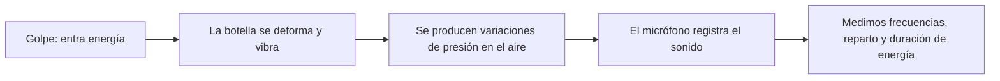
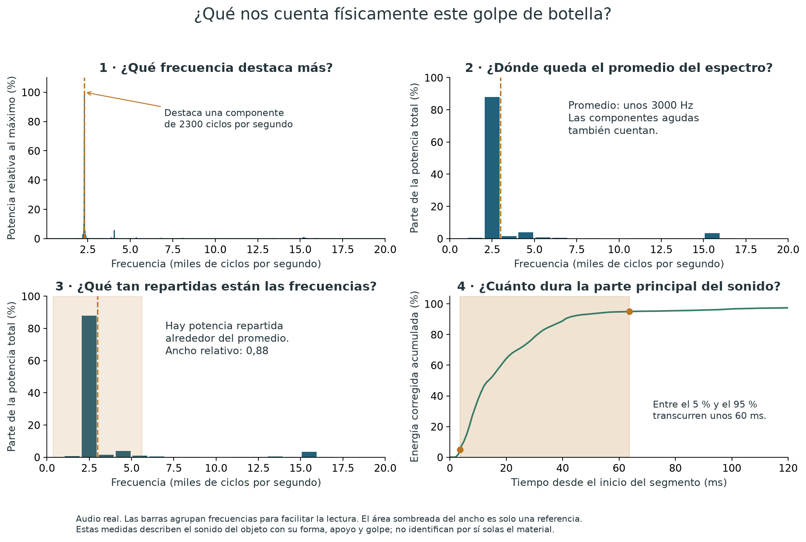

# Qué podemos aprender de un objeto escuchando un golpe

**Queremos describir físicamente la respuesta de objetos de madera, vidrio,
hierro y plástico rígido cuando los golpeamos:** qué frecuencias aparecen,
cómo se reparte el sonido entre ellas y cómo disminuye después del impacto.
Después comprobamos si esas características ayudan a distinguir las categorías.

Vamos a verlo con **un golpe real de una botella de vidrio**, desde cero.
No hace falta saber programación ni entender una FFT para seguir esta explicación.

**[Escucha el golpe aquí](../examples/botella_vidrio/botella_golpe01.wav).**
GitHub puede pedirte descargar el archivo para escucharlo. El fragmento dura
menos de un segundo e incluye un poco de fondo antes del golpe.

## 1. Qué sucede físicamente cuando golpeamos la botella

El golpe le entrega energía a la botella. Sus paredes se deforman un poco y
vibran. Esa vibración mueve el aire, el sonido llega al micrófono y el celular
lo convierte en una señal que podemos estudiar.

Un objeto puede vibrar de varias maneras al mismo tiempo. Por eso un golpe
puede contener **muchas frecuencias**, aunque al escucharlo parezca un único sonido.
Cada forma de vibrar se denomina *modo de vibración*. Identificar esos modos
exige más trabajo que buscar el punto más alto de un espectro.

La forma, el tamaño, el espesor, el apoyo y la zona golpeada también intervienen.
Por ejemplo, dos recipientes de vidrio pueden sonar muy distintos. Los estudios
de [vibraciones de recipientes de vidrio de Rossing](https://acoustics.org/pressroom/httpdocs/147th/Rossing_Harmonicas1.htm)
muestran distintas formas de vibración y cambios de frecuencia al modificar el recipiente.

## 2. La primera gráfica: cómo cambia el sonido con el tiempo

**Cómo leerla:** de izquierda a derecha pasa el tiempo. La altura de la línea
representa la amplitud de la señal del micrófono. Sus oscilaciones rápidas
corresponden a las variaciones de la señal sonora; no muestran directamente
cuánto se mueve la pared de la botella.

Antes del golpe hay una señal pequeña: el **fondo**. Al golpear aparece una señal
grande y después se va reduciendo. Esto permite observar el inicio y la caída
del sonido registrado.

Los colores señalan los fragmentos que analizamos:

- **Fondo anterior:** sirve para estimar la señal que ya había antes de golpear.
- **Primeros 100 ms:** los usamos para estudiar qué frecuencias contiene el golpe.
- **Fragmento temporal de 506 ms:** lo usamos para seguir su energía hasta cerca del fondo.

Un milisegundo, abreviado **ms**, es una milésima de segundo. Los tiempos
negativos de la gráfica son los instantes anteriores al inicio del segmento.
La ventana de 506 ms incluye una cola débil; su longitud no es automáticamente
la duración de la parte principal del sonido.

## 3. Qué cuatro características medimos

### A. Frecuencia prominente: ¿qué componente destaca más?

El espectro es una manera de separar el sonido según sus frecuencias. En la
gráfica, hacia la derecha están las frecuencias más altas; hacia arriba, las
que tienen mayor potencia según el cálculo.

**Una frecuencia de 2300 Hz significa 2300 ciclos por segundo en esa componente
del sonido.** En este golpe, la componente de mayor potencia está en 2300 Hz.
A ese valor lo llamamos **frecuencia prominente**, o fₚ.

Su relación física es con las oscilaciones que destacan en la señal registrada.
Para una componente tonal, una frecuencia mayor corresponde a un tono más agudo.
En un impacto con muchos componentes, fₚ no describe por sí sola todo lo que oímos.

**Qué podemos afirmar:** en este golpe de esta botella destaca una componente
de 2300 Hz. Para llamarla frecuencia de un modo propio habría que identificarlo;
no hemos establecido una frecuencia única que caracterice al vidrio como material.

### B. Centroide: ¿dónde queda el promedio de las frecuencias?

Ahora contamos **todas** las frecuencias de la banda analizada. Las que tienen
más potencia cuentan más en el promedio; las débiles cuentan menos.
Ese promedio se llama **centroide**, o C.

En este ejemplo queda en **unos 3000 Hz**. Es mayor que 2300 Hz porque también
hay potencia en otras frecuencias, incluidas frecuencias más altas.

Su relación física es con **cómo se distribuye la potencia del sonido entre
frecuencias**. Puede describir un aspecto de su carácter más grave o más agudo,
pero no es necesariamente la nota que escucharíamos ni otro modo de vibración.

Una comparación útil: fₚ señala el pico más alto; C considera el conjunto del
espectro. Dos golpes pueden tener el mismo pico y diferentes centroides.

### C. Ancho relativo: ¿la potencia está concentrada o repartida?

Puede haber mucha potencia cerca del promedio, o una parte importante a
frecuencias bastante alejadas. Medimos esa dispersión con un **ancho espectral B**.
Después lo dividimos por C para expresar el ancho en relación con el promedio.
De ahí el nombre **B/C**, ancho de banda relativo.

Para esta botella obtenemos **B/C ≈ 0,88**, sin unidad. Ese número resume la
dispersión relativa del espectro: para saber si resulta grande o pequeño en
nuestro experimento hay que compararlo con los demás golpes y objetos.

Su relación física es con el **reparto de potencia entre componentes del sonido**.
No cuenta cuántos modos tiene la botella ni mide directamente una pérdida de energía.
Junto con el centroide describe parte de la forma del espectro, que contribuye
al carácter o *timbre* del sonido.

En la gráfica, la zona sombreada ayuda a situar ese ancho alrededor del promedio.
No significa que toda la potencia esté dentro de ella. Las barras agrupan
frecuencias solo para que la distribución sea más fácil de leer.

### D. Duración energética: ¿cuánto dura la parte principal del sonido?

Volvemos a la señal del micrófono. Para seguir su energía usamos el cuadrado de
la amplitud: las oscilaciones grandes aportan más que las pequeñas. Descontamos
una estimación de la potencia del fondo en pequeños bloques de tiempo y sumamos
los aportes a medida que pasa el tiempo.

Imagina una cuenta que va del **0 % al 100 %** de la energía corregida del
segmento. Marcamos cuándo llega al 5 % y cuándo llega al 95 %. El tiempo que
pasa entre esas marcas se llama **D₉₀**.

En este golpe, el 5 % se alcanza aproximadamente a los **3,6 ms** y el 95 %
a los **63,7 ms**. Entre ambas marcas pasan **unos 60 ms**.

Su relación física es con **la persistencia temporal de la energía sonora
registrada**. Sirve para comparar cuánto se prolonga la parte energéticamente
principal de distintos golpes bajo el mismo protocolo.

Puede quedar sonido después de D₉₀. Además, el apoyo, el ambiente y la grabación
afectan esta duración. Por eso D₉₀ no es por sí solo una medida del amortiguamiento
interno del vidrio. Para estudiar un tiempo modal de decaimiento τ tendríamos
que aislar una vibración y comprobar cómo cae su amplitud.

## 4. La lectura física completa de este ejemplo

| Pregunta | Medida | Resultado aproximado | Qué estamos describiendo |
|---|---|---:|---|
| ¿Qué componente destaca? | fₚ | 2300 Hz | Máximo del espectro del sonido |
| ¿Dónde está el promedio? | C | 3000 Hz | Distribución de potencia en frecuencia |
| ¿Qué tan repartida está? | B/C | 0,88 | Dispersión relativa del espectro |
| ¿Cuánto dura la parte principal? | D₉₀ | 60 ms | Distribución de energía en el tiempo |

**Estas son características físicas de la señal acústica producida por el objeto
bajo nuestro montaje.** Buscamos si presentan patrones repetibles asociados a
las categorías declaradas, teniendo en cuenta las diferencias entre objetos.

El micrófono nos proporciona una observación acústica de la vibración. Para
atribuir cambios exclusivamente al material, debemos controlar o estudiar también
la forma, las dimensiones, el golpe y el apoyo. Todavía no hemos medido directamente
densidad, dureza, módulo elástico ni amortiguamiento interno del material.

## 5. Qué papel tiene el modelo

Cada golpe se transforma en una fila con esos cuatro números. El modelo busca
si los ejemplos etiquetados como madera, vidrio, hierro o plástico presentan
patrones que le permitan clasificar **otro objeto**.

La interpretación física viene antes: comprobar qué mide cada número, si se
repite al golpear el mismo objeto y cuánto cambia entre objetos de una categoría.
La clasificación es una prueba adicional de la utilidad de esas características;
una puntuación alta no demostraría por sí sola una ley física del material.

Este es el objetivo que guía el experimento: **medir, interpretar y comparar
respuestas acústicas**, y después evaluar qué información permiten extraer sobre
las categorías de objetos disponibles.

## 6. Para quien quiera comprobar los cálculos

- [Fórmulas, ventanas y números sin redondear del ejemplo](tutorial_tecnico.md).
- [Audio WAV real](../examples/botella_vidrio/botella_golpe01.wav).
- [Script que calcula los valores y regenera las gráficas](../examples/botella_vidrio/reproducir.py).
- [Método completo del proyecto](metodo_descriptores.md).

Los valores de esta página son los del método original. La alternativa que
desplaza la ventana espectral 10 ms se documenta por separado en la explicación
técnica. Ningún cálculo ni resultado del modelo se cambió al simplificar este tutorial.
