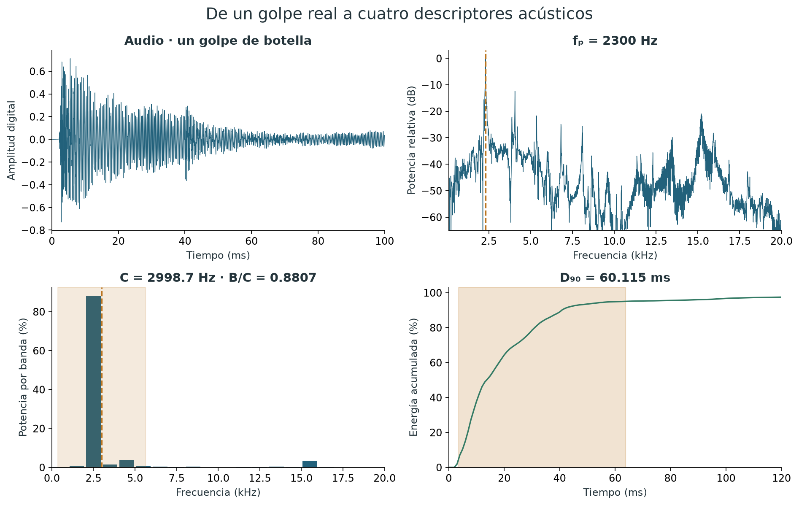
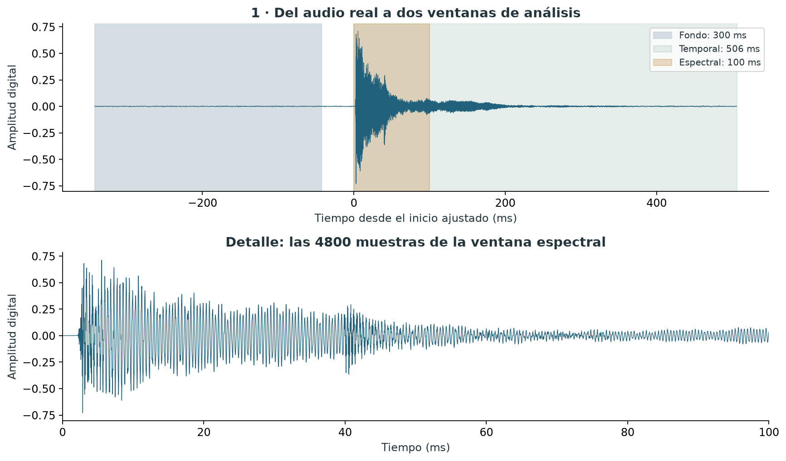
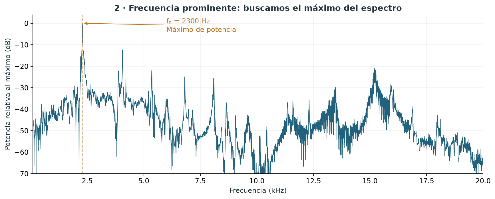
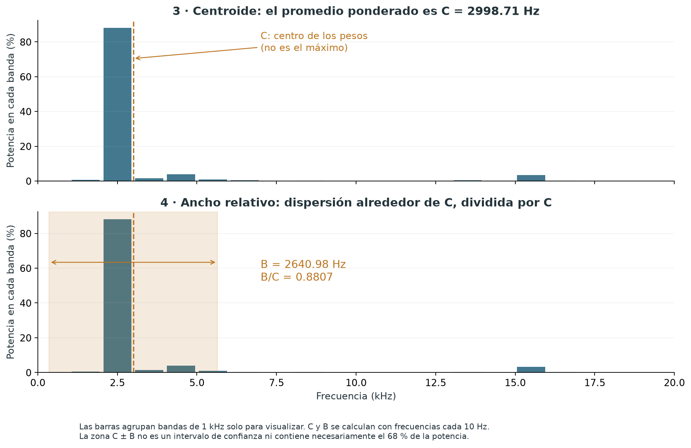
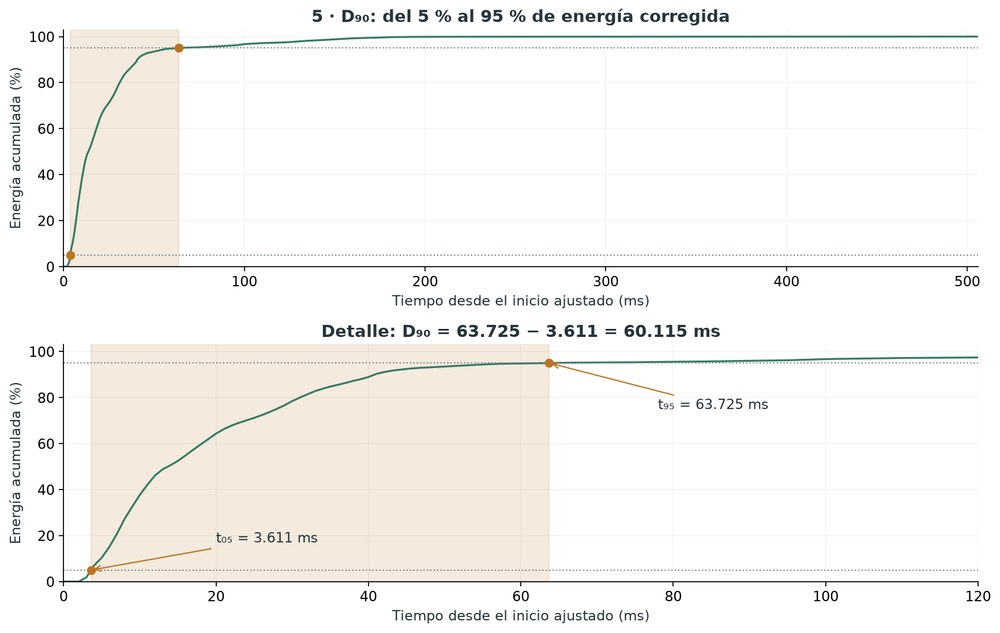

# De un golpe real a cuatro características acústicas

Este ejemplo sigue el **primer golpe aceptado de una botella de vidrio**
(`SES008_G01`). El audio es real: se incluye un recorte con fondo anterior y
el golpe completo, conservando exactamente las muestras de la copia PCM.
Las cifras de esta página corresponden al método original `piloto_v1`.



| Descriptor | Valor del golpe | Unidad |
|---|---:|---|
| Frecuencia prominente, fₚ | 2300 | Hz |
| Centroide, C | 2998,7063 | Hz |
| Ancho relativo, B/C | 0,880707 | Sin unidad |
| Duración energética, D₉₀ | 60,1147 | ms |

**Escuchar y revisar:** [audio WAV del ejemplo](../examples/botella_vidrio/botella_golpe01.wav)
· [parámetros y procedencia](../examples/botella_vidrio/manifest.json)
· [resultados sin redondear](../examples/botella_vidrio/resultados.json)
· [código que reproduce las figuras](../examples/botella_vidrio/reproducir.py).

GitHub puede ofrecer descarga en lugar de reproducción del WAV. El recorte dura
0,8485 s e incluye el fondo utilizado para corregir la duración. No contiene
todos los golpes de la botella ni representa por sí solo a la categoría vidrio.

## 1. Qué registra el micrófono

Un audio digital es una secuencia de números `x[n]`: amplitudes de señal a
intervalos regulares. En este caso hay un canal, 48000 muestras por segundo y
almacenamiento PCM de 24 bits. El tiempo entre muestras es:

$$\Delta t=\frac{1}{48000}\ \mathrm{s}\approx20{,}83\ \mu\mathrm{s}.$$

Las amplitudes se representan en escala digital: no son pascales. Como el sistema
no está calibrado, no obtenemos presión sonora, nivel dB SPL, energía en joules
ni propiedades mecánicas directas como dureza o módulo de Young.

El sonido depende del objeto, su forma, apoyo, golpe, ambiente y sistema de
grabación. Los descriptores resumen la respuesta medida bajo ese montaje.

## 2. Por qué necesitamos varias ventanas



La gráfica superior muestra el audio con el tiempo cero en el **inicio ajustado
del segmento**, dos milisegundos antes del frente detectado. Por eso el fondo
anterior tiene tiempos negativos. La gráfica inferior amplía el fragmento que
entra al cálculo espectral.

| Ventana | Tiempo respecto al inicio ajustado | Uso |
|---|---|---|
| Fondo | −342,5 a −42,5 ms | Estimar media y potencia del fondo previo |
| Espectral | 0 a 100 ms | Calcular fₚ, C y B/C |
| Temporal | 0 a 506 ms | Buscar el 5 % y el 95 % de la energía corregida |

Los índices se guardan como intervalos `[inicio, fin)`: incluyen la muestra inicial
y excluyen la final. La ubicación en la grabación completa también está documentada
en el manifest; las gráficas usan tiempos relativos para facilitar la lectura.

La ventana temporal acaba tras verificar retorno cerca del fondo. **Su longitud
no es D₉₀**: una parte larga puede contener muy poca energía después del impacto.
En la adquisición, la selección de ventanas es una decisión metodológica; aquí
no se ajustaron sus límites para que la botella fuera reconocida por el modelo.

## 3. Del tiempo al espectro con la FFT

Tomamos 100 ms: `48000 × 0,100 = 4800` muestras. Restamos su media y aplicamos
una ventana de peso casi constante: rampa sin² de 1 ms al inicio y rampa cos²
de 10 ms al final. Estas transiciones reducen discontinuidades de borde sin
emplear un filtrado del archivo original.

La FFT transforma esas muestras en contribuciones de frecuencia. Para una
frecuencia `f[k]` calculamos una densidad de potencia proporcional a:

$$P_k=\frac{|\operatorname{FFT}((x-\bar{x})w)_k|^2}{f_s\sum_nw_n^2}.$$

Para el espectro unilateral se duplican las contribuciones positivas salvo los
extremos que no tienen un par diferente. El código contempla el caso de Nyquist.
Conservamos la banda **100–20000 Hz**, común a todos los golpes, sin restar
el fondo en los tres descriptores espectrales del método original.

La separación entre frecuencias de la FFT es `48000/4800 = 10 Hz`.
Esto es el espaciado de la rejilla de cálculo; no garantiza resolver dos modos
físicos separados 10 Hz ni medir frecuencias con exactitud de 10 Hz.

## 4. Primera característica: frecuencia prominente



Buscamos el punto de mayor potencia dentro de la banda:

$$f_p=f_{\arg\max_kP_k}=2300\ \mathrm{Hz}.$$

La gráfica usa decibelios relativos al máximo para mostrar componentes mucho
más débiles: el punto más alto tiene 0 dB por definición. No son dB SPL.
El cálculo se hace con potencias lineales, **no con las alturas en decibelios**.

Este máximo tampoco identifica automáticamente la frecuencia fundamental ni
un modo propio. En objetos con varios picos, el máximo puede cambiar entre
golpes aunque sigan presentes las mismas regiones espectrales.

## 5. Segunda característica: centroide espectral



Imagina que cada frecuencia tiene un peso proporcional a la potencia que aporta.
El centroide es el promedio de todas esas frecuencias con sus pesos:

$$q_k=\frac{P_k}{\sum_jP_j},\qquad C=\sum_k f_kq_k.$$

Para este golpe:

$$C=2998{,}7063\ \mathrm{Hz}.$$

El máximo está en 2300 Hz, pero existen otras contribuciones a frecuencias
mayores. Por eso el promedio ponderado queda por encima del máximo. **Pico y
centroide responden preguntas diferentes:** cuál es la componente más potente
y dónde se concentra, en promedio, toda la potencia considerada.

Las barras agrupan bandas de 1 kHz para hacer visible la idea de pesos.
Los números exactos se calculan con los **1991 puntos de frecuencia** entre
100 y 20000 Hz, espaciados 10 Hz. Puedes comprobar las sumas en
[espectro.csv](../examples/botella_vidrio/espectro.csv).

## 6. Tercera característica: ancho de banda relativo

Medimos cuánto se dispersan las frecuencias alrededor de C, manteniendo los
mismos pesos de potencia:

$$B=\sqrt{\sum_k(f_k-C)^2q_k}=2640{,}9816\ \mathrm{Hz}.$$

Después dividimos por el centroide:

$$\frac{B}{C}=\frac{2640{,}9816}{2998{,}7063}=0{,}880707.$$

El modelo utiliza **B/C**, un número sin unidades; B en Hz se conserva para
interpretar el cálculo. Un cociente mayor indica más dispersión en relación
con el centroide. No tiene por qué estar entre cero y uno.

La zona sombreada en la gráfica es `C ± B`, solo una referencia visual.
No es el intervalo que contiene necesariamente el 68 % de la potencia ni
un intervalo de confianza. No se supone una distribución gaussiana.

## 7. Cuarta característica: duración energética D₉₀

Aquí volvemos a la **señal en el tiempo**. No se usa el taper espectral ni
se filtra a la banda de 100–20000 Hz. Primero quitamos la media del fondo
previo y estimamos su potencia media:

$$p_{\mathrm{fondo}}=3{,}893947052\times10^{-6}$$

en unidades digitales al cuadrado. Agrupamos la señal en bloques de 1 ms,
48 muestras cada uno, y calculamos:

$$E_j=\max\left(\sum_{n\in j}(x_n-\bar{x}_{\mathrm{fondo}})^2-N_jp_{\mathrm{fondo}},\ 0\right).$$

La resta ocurre **antes** de recortar a cero. El recorte impide que la energía
acumulada disminuya, pero puede dejar sesgo residual de fondo. Este procedimiento
es una estimación operativa; no separa perfectamente ruido y sonido del objeto.
El factor constante `1/fs` no cambia los porcentajes acumulados y se omite.



Acumulamos los bloques y dividimos por su suma total. Buscamos los instantes
donde alcanzamos el 5 % y el 95 %. Suponiendo energía uniforme dentro del bloque,
interpolamos para situar cada cruce:

$$t_{05}=3{,}610573\ \mathrm{ms},\qquad t_{95}=63{,}725297\ \mathrm{ms}.$$

La resta da:

$$D_{90}=t_{95}-t_{05}=60{,}114725\ \mathrm{ms}.$$

Los muchos decimales permiten comprobar la reproducción numérica; no expresan
esa precisión física. La resolución efectiva de este procedimiento es de
aproximadamente 1 ms, condicionada también por el fondo y los límites elegidos.

**Interpretación:** el 90 % central de la energía corregida de este golpe se
acumula en unos 60 ms, aunque la ventana completa tenga 506 ms. D₉₀ no es
el tiempo de reverberación del recinto, ni τ, ni un tiempo modal de amortiguamiento.
Las columnas de [energia.csv](../examples/botella_vidrio/energia.csv) permiten
seguir la corrección y la acumulación bloque por bloque.

## 8. Cómo se convierte en una fila para el modelo

La fila correspondiente a este golpe es:

```text
fₚ = 2300 Hz
C  = 2998.7063 Hz
B/C = 0.880707
D₉₀ = 0.060114725 s
```

El espectral recibe los primeros tres números; el temporal recibe D₉₀;
el combinado recibe los cuatro. El material declarado es la etiqueta que
queremos predecir, **no una variable de entrada**. El objeto_id se utiliza para
separar entrenamiento y evaluación y evitar que sus golpes aparezcan a ambos lados.

La mediana por objeto sirve para describir sus repeticiones. En la clasificación
actual se entrenó con los golpes y se promediaron sus probabilidades para obtener
la predicción de cada objeto excluido; no se entrenó directamente con las medianas.

## 9. Qué cambia en la alternativa de 10 ms

El diagnóstico posterior desplaza la ventana espectral de `[0,100)` a
`[10,110)` ms respecto al inicio ajustado. Mantiene longitud, banda y fórmulas.
D₉₀ se conserva. No debe confundirse esa alternativa exploratoria con el método
original que reproduce esta página. Los valores alternativos del mismo golpe
también se calculan en `resultados.json`.

Una mejora de clasificación tras desplazar la ventana no demuestra que se haya
eliminado el sonido del percutor ni que el método generalice. Es necesario comprobar
la decisión con nuevos objetos, sin seguir escogiendo parámetros sobre los mismos ocho.

## 10. Reproducir y verificar

Desde la raíz del repositorio, con Python 3.12:

```bash
python -m venv .venv
source .venv/bin/activate
python -m pip install -e ".[dev,analisis]"
python examples/botella_vidrio/reproducir.py
python -m pytest
```

En Windows, activa el entorno con `.venv\Scripts\activate`. El script verifica
el SHA-256 del recorte y compara los siete resultados numéricos auxiliares y
principales con los de la extracción original. Después regenera las cinco figuras,
el espectro, la energía por bloques y los resultados JSON. No necesita los demás
audios del piloto ni sobrescribe sus datos de trabajo.

## Referencias y alcance

- [NumPy: FFT unilateral para señales reales](https://numpy.org/doc/stable/reference/generated/numpy.fft.rfft.html).
- [SciPy: definición y escalado del periodograma](https://docs.scipy.org/doc/scipy/reference/generated/scipy.signal.periodogram.html).
- [Método completo de extracción del proyecto](metodo_descriptores.md).

Las rampas, banda, longitud de ventana y corrección de fondo son decisiones
documentadas de este proyecto. Las bibliotecas no garantizan que esos parámetros
sean óptimos para clasificar materiales. Este ejemplo explica cómo se obtienen
los valores; no prueba que una botella permita reconocer todos los vidrios.
