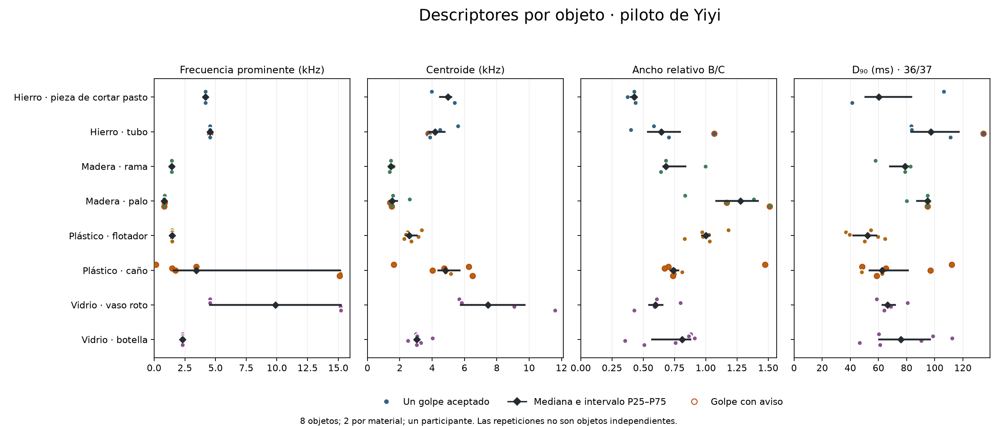

# Descriptores acústicos del piloto

Se calcularon los tres descriptores espectrales en los **37 golpes aceptados**, de ocho objetos. D₉₀ fue estimable en **36**. Se conservaron las cinco exclusiones de la revisión de escucha.

Las ventanas espectrales son de 100 ms, con banda de 100 a 20000 Hz. Las ventanas temporales se ajustan al retorno al fondo y descuentan su contribución por bloques de 1 ms. El método y sus límites están en [método v1](../../docs/metodo_descriptores.md).

## Medianas por objeto

| Objeto | Golpes | fₚ (Hz) | C (Hz) | B/C | D₉₀ (ms) | n D₉₀ |
|---|---:|---:|---:|---:|---:|---:|
| Hierro · pieza de cortar pasto | 3 | 4170 | 4986 | 0.426 | 60.2 | 3 |
| Hierro · tubo | 4 | 4560 | 4177 | 0.644 | 97.3 | 4 |
| Madera · rama | 3 | 1430 | 1455 | 0.682 | 79.0 | 3 |
| Madera · palo | 4 | 835 | 1533 | 1.277 | 94.8 | 3 |
| Plástico · flotador | 6 | 1460 | 2595 | 1.001 | 52.3 | 6 |
| Plástico · caño | 7 | 3420 | 4825 | 0.742 | 62.6 | 7 |
| Vidrio · vaso roto | 4 | 9875 | 7450 | 0.599 | 66.4 | 4 |
| Vidrio · botella | 6 | 2300 | 3055 | 0.810 | 75.8 | 6 |

Los valores sin redondear, junto con P25 y P75, están en [por_objeto.csv](../../datos/caracteristicas/piloto_v1/por_objeto.csv). La tabla resume repeticiones, no estima propiedades intrínsecas del material. Una mediana de frecuencias máximas puede quedar entre dos picos y no coincidir con un pico medido.

## Controles de calidad: 8 golpes con avisos

El cuarto golpe del palo de madera (**SES004_G04**) no vuelve al fondo antes del límite de 750 ms. Se mantiene aceptado como evento, pero su D₉₀ principal queda vacío y no participa en la mediana. La duración que resultaría de la ventana limitada se conserva solo como diagnóstico.

| Golpe | Avisos |
|---|---|
| SES002_G03 | baja relacion energia fondo |
| SES004_G03 | baja relacion energia fondo |
| SES004_G04 | no retorna al fondo antes del limite; baja relacion energia fondo |
| SES006_G01 | baja relacion energia fondo; d90 sensible a fondo o final; frecuencia prominente sensible a ventana |
| SES006_G02 | frecuencia prominente sensible a ventana |
| SES006_G03 | frecuencia prominente sensible a ventana |
| SES006_G04 | d90 sensible a fondo o final |
| SES006_G07 | d90 sensible a fondo o final |

Las frecuencias prominentes del caño cambian entre máximos competidores; tres golpes cambian más del 20 % al usar 80 o 120 ms. En el vaso roto hay dos golpes con máximos cerca de 4.55 kHz y dos cerca de 15.2 kHz. Hay energía cerca de 15 kHz en varios objetos: su origen no está identificado y estos máximos no deben presentarse como modos propios del material.

Los avisos de sensibilidad no son intervalos de confianza. Los valores con avisos permanecen en los archivos y los resúmenes para no aplicar exclusiones adicionales después de ver los resultados. El D₉₀ sin cola aislada es un dato no estimable.

## Archivos y verificación

- [Descriptores por golpe](../../datos/caracteristicas/piloto_v1/por_golpe.csv).
- [Límites de las ventanas](../../datos/caracteristicas/piloto_v1/ventanas.csv).
- [Cálculos y diagnósticos completos](calculo.json).

Las 37 ventanas WAV se compararon muestra por muestra con sus copias fuente. Se verificaron índices, pertenencia a los eventos aceptados, resúmenes por objeto y hashes de los originales. Las 20 pruebas del código pasaron. No se entrenaron modelos ni se realizaron pruebas de hipótesis.

## Figuras de cada grabación

- [SES001: ventanas, espectros y energía acumulada](figuras/SES001.png).
- [SES002: ventanas, espectros y energía acumulada](figuras/SES002.png).
- [SES003: ventanas, espectros y energía acumulada](figuras/SES003.png).
- [SES004: ventanas, espectros y energía acumulada](figuras/SES004.png).
- [SES005: ventanas, espectros y energía acumulada](figuras/SES005.png).
- [SES006: ventanas, espectros y energía acumulada](figuras/SES006.png).
- [SES007: ventanas, espectros y energía acumulada](figuras/SES007.png).
- [SES008: ventanas, espectros y energía acumulada](figuras/SES008.png).
