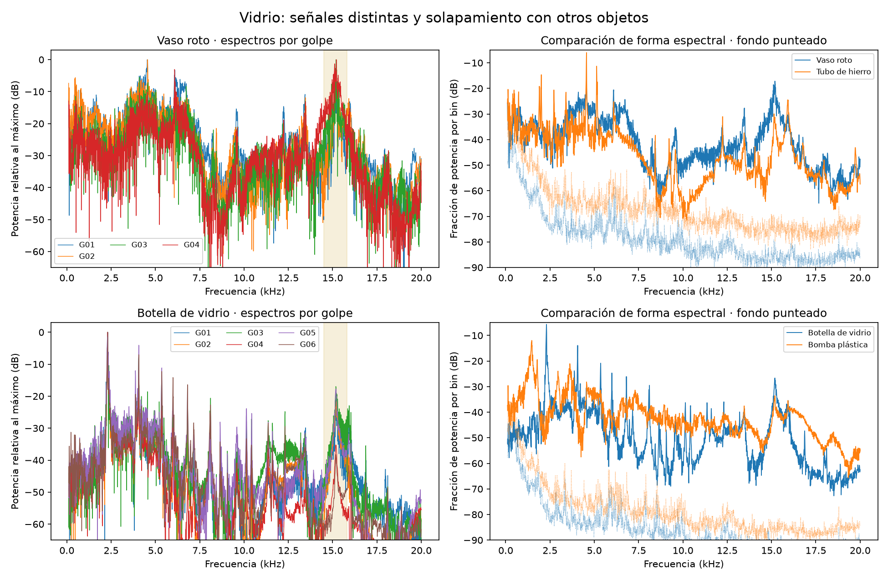

# Por qué fallan los dos objetos de vidrio

**La dificultad principal observada es representar una categoría con dos
objetos que suenan de manera distinta. Las señales de vidrio tienen bastante
energía respecto al fondo; los cambios de tratamiento del ruido no corrigieron
ninguno de los dos errores.** Esto es un diagnóstico de la muestra disponible,
no una identificación causal completa del sistema objeto–percutor–apoyo–teléfono.

## Evidencia de las grabaciones

| Aspecto | Vaso roto (OBJ007) | Botella (OBJ008) |
|---|---|---|
| Golpes aceptados | 4 | 6 |
| Frecuencia prominente | 4540, 4560, 15190 y 15210 Hz | 2300–2310 Hz |
| Centroide, mediana | 7450 Hz | 3055 Hz |
| D90, mediana | 66.4 ms | 75.8 ms |
| Potencia media de ventana / fondo | 19.8–25.9 dB | 23.0–31.4 dB |
| Predicción de la fusión inicial | Hierro | Plástico rígido |

Al excluir el vaso, la categoría vidrio queda representada únicamente por la
botella. Al excluir la botella, queda únicamente el vaso. Ningún entrenamiento
contiene otros ejemplos de vidrio que cubran esa diversidad. No significa que
estos objetos estén mal etiquetados ni que el vidrio carezca de información
acústica; significa que no hemos observado suficientemente la categoría.

El máximo del tubo de hierro es 4560 Hz: se superpone con dos golpes del vaso.
La botella tiene un centroide cercano al del flotador plástico (mediana 2595 Hz),
y las duraciones de ambos vidrios se superponen con las de otros materiales.
Los cuatro resúmenes no identifican de forma exclusiva el material en este piloto.

La frecuencia prominente no es necesariamente una frecuencia modal identificada.
En el vaso compiten dos regiones del espectro; su mediana de 9875 Hz cae entre
los máximos medidos. El clasificador original utiliza golpes individuales, por
lo que ese valor intermedio no fue la causa de su error.

## Qué descartó la revisión

- No hay muestras próximas al límite digital en las ventanas originales; esto
  no descarta procesamiento previo del teléfono, que no está documentado.
- Los archivos son ALAC sin pérdida, a 48000 Hz. Pasarlos otra vez a WAV no
  crearía información adicional; ya se trabaja con copias PCM verificadas.
- Restar el espectro del fondo cambia el centroide de los golpes de vidrio
  menos del 0.6 % y no corrige sus clasificaciones. El fondo continuo estimado
  no parece la explicación principal de estos dos errores.
- La banda 14.5–15.8 kHz aporta aproximadamente 6–61 % de la potencia espectral
  medida del vaso, dependiendo del golpe. Está muy por encima del fondo previo
  y persiste al desplazar el inicio de ventana. No hay fundamento para llamarla
  simplemente ruido ambiental y eliminarla selectivamente del vidrio.

Esa región aparece también, con otras proporciones, en otros objetos. Podría
incluir vibración del objeto, percutor, apoyo, respuesta del sistema de grabación
o una combinación. Estas grabaciones no separan esas contribuciones; falta un
control experimental. No se atribuye el pico a la cuchara como hecho demostrado.

## Cambios probados con los mismos audios

Se definieron tres cambios y se aplicaron a **todos los objetos**, conservando
los mismos 36 golpes completos, los mismos ocho objetos excluidos por ronda,
la ponderación y los parámetros del bosque. D90 no cambió. La fusión promedia
las probabilidades del espectral correspondiente y el temporal original.

| Tratamiento espectral | Espectral | Combinado | Fusión 50/50 | Vidrios acertados |
|---|---:|---:|---:|---:|
| Original, referencia | 2/8 (25 %) | 1/8 (12.5 %) | 4/8 (50 %) | 0/2 en todos |
| Restar fondo espectral | 2/8 (25 %) | 1/8 (12.5 %) | 4/8 (50 %) | 0/2 en todos |
| Desplazar inicio 10 ms; conservar 100 ms | 4/8 (50 %) | 5/8 (62.5 %) | 6/8 (75 %) | 0/2 en todos |
| Reducir banda a 100–10000 Hz | 4/8 (50 %) | 4/8 (50 %) | 4/8 (50 %) | 0/2 en todos |

La ventana desplazada elimina los primeros 10 ms de la ventana de análisis
original y añade 10 ms al final; no filtra el archivo ni permite aislar por sí
sola la respuesta del objeto. El cambio de resultado indica sensibilidad a la
parte del impacto resumida. No demuestra que la cuchara sea la causa.

El 75 % corresponde a acertar los seis objetos de otros materiales y fallar
los dos vidrios. Es una candidata útil para probar prospectivamente, pero todavía
no resuelve el problema planteado. No basta una métrica global cuando una clase
tiene recuperación cero.

Todos estos resultados son **exploratorios y posteriores a observar la evaluación
inicial**. Se reutilizan ocho objetos y se comparan varias alternativas. No son
una nueva prueba independiente, no validan H3 y no sustituyen el método v1. No
se borraron errores, cambiaron etiquetas ni seleccionaron golpes para favorecer
una variante. No se ensayaron cortes de banda adicionales buscando un ganador.

## Qué podemos aprovechar ahora

1. Conservar los audios originales, el método v1 y la revisión de escucha.
   Registrar la ventana desplazada como candidata para las próximas pruebas,
   manteniendo separados los resultados originales y los diagnósticos.
2. Mostrar espectros completos, dispersión de los golpes y varias regiones
   prominentes del vaso; no interpretar un único máximo como huella inequívoca
   del material. Con más objetos podrá evaluarse una representación más rica
   del espectro, como bandas o varios picos, con selección dentro del entrenamiento.
3. Revisar la actividad posterior del golpe de madera sin D90 como problema
   de duración separado; no afecta directamente a que ambos vidrios fallen.
4. Usar nuevos objetos como comprobación prospectiva, además de ampliar la
   evaluación por objeto. Evitar seguir escogiendo parámetros con estos mismos ocho.

## Próximas grabaciones: prioridades

- **Más vidrios distintos e intactos**, conservando tamaños y formas variados:
  vasos, botellas y frascos. El vaso roto se conserva en este piloto y se registra
  como tal; nuevas muestras intactas ayudarán a describir otra parte de la categoría.
  También hacen falta formas comparables en plástico y metal para evitar que
  el modelo aprenda simplemente “recipiente = vidrio”.
- **Punto de golpe y apoyo reproducibles.** Marcar la zona, fotografiar la
  colocación y mantener el mismo número de pliegues del paño. No sujetar paredes
  vibrantes con los dedos ni mover el objeto entre golpes. Registrar cualquier
  cambio de apoyo como otra colocación; afecta especialmente a la duración.
- **Teléfono fijo a 20 cm**, con el micrófono orientado de la misma manera y
  sin tocarlo durante el ensayo. Si es posible, soporte separado de la superficie
  golpeada, para reducir transmisión mecánica directa al teléfono.
- **Cinco golpes suaves y separados**, de intensidad semejante; dejar al menos
  tres segundos entre golpes o más si todavía se oye la cola. Grabar tres segundos
  de fondo antes y después, sin hablar ni manipular objetos durante el bloque.
- **Control del percutor.** Antes de cambiar el protocolo, comparar cuchara y
  una varilla de madera pequeña con el mismo objeto intacto, sin cambiar apoyo,
  teléfono ni distancia. Hacer cinco golpes con cada uno en un objeto de vidrio
  y, si es posible, uno de hierro y uno de plástico. El percutor cambia la excitación;
  la comparación evalúa repetibilidad, no garantiza separar su sonido puro.
  Una vez elegido, usar el mismo tipo en todos los materiales. No cambiar solo vidrio.
- **Registrar aplicación y ajustes**, exportar el archivo original y evitar
  aplicar mejoras de voz, ecualización o limpieza antes del análisis. No sabemos
  qué aplicación produjo estos audios. Si se usa Notas de Voz, Apple ofrece funciones
  de reducción de ruido y reverberación; no deben introducirse como procesamiento
  inadvertido. El formato actual ya es sin pérdida.

La lista operativa y los identificadores de controles están en
[la propuesta de grabación](../../docs/protocolo_grabacion_propuesto.md).
Son recomendaciones para un bloque de prueba; no se modificó el anteproyecto
ni se añadieron condiciones desconocidas a los metadatos existentes.

## Archivos de respaldo y fuentes

- `control_senales.csv`: diagnósticos por golpe, incluido el contraste con el fondo.
- `predicciones.csv`: 72 predicciones por objeto de las tres variantes y tres modelos.
- `diagnostico.json`: criterios, resultados y hashes de originales.
- Código reproducible: `scripts/diagnosticar_vidrio.py`.
- [Rossing, Acoustics of Glass Harmonicas, ASA](https://acoustics.org/pressroom/httpdocs/147th/Rossing_Harmonicas1.htm):
  la forma del vidrio, su espesor y la forma de excitación influyen en los modos y frecuencias observados.
- [Apple, funciones de Notas de Voz](https://apps.apple.com/us/app/voice-memos/id1069512134):
  la aplicación ofrece grabación y funciones de mejora que reducen ruido y reverberación.
