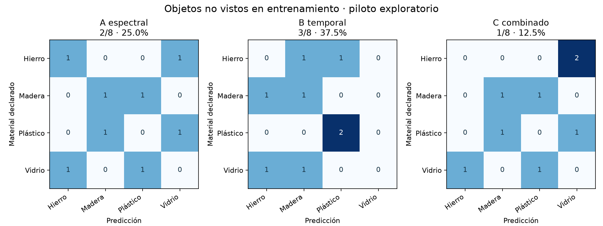

# Primera prueba de clasificación

**Evaluación exploratoria de ocho objetos, dos por material, de un participante.** Los resultados se refieren a objetos excluidos del entrenamiento en cada ronda.

| Modelo | Predictores | Aciertos por objeto | Exactitud balanceada | Rango descriptivo de remuestreo |
|---|---|---:|---:|---:|
| A_espectral | fp_hz, centroide_hz, ancho_relativo | 2/8 | 25.0% | 0.0%–50.0% |
| B_temporal | d90_s | 3/8 | 37.5% | 25.0%–50.0% |
| C_combinado | fp_hz, centroide_hz, ancho_relativo, d90_s | 1/8 | 12.5% | 0.0%–25.0% |

La referencia de predicción uniforme tiene una exactitud balanceada esperada del 25 %. Predecir siempre hierro en los ocho objetos también obtiene 25 %. No se usa la exactitud sobre los datos de entrenamiento como resultado.

## Qué ocurrió con cada objeto

| Objeto | Material declarado | Espectral | Temporal | Combinado |
|---|---|---|---|---|
| Pieza de cortar pasto (OBJ001) | hierro | hierro ✓ | plastico rigido ✗ | vidrio ✗ |
| Tubo de hierro (OBJ002) | hierro | vidrio ✗ | madera ✗ | vidrio ✗ |
| Rama de árbol (OBJ003) | madera | plastico rigido ✗ | madera ✓ | plastico rigido ✗ |
| Palo para sostener (OBJ004) | madera | madera ✓ | hierro ✗ | madera ✓ |
| Bomba plástica (OBJ005) | plastico rigido | madera ✗ | plastico rigido ✓ | madera ✗ |
| Caño (OBJ006) | plastico rigido | vidrio ✗ | plastico rigido ✓ | vidrio ✗ |
| Vaso roto (OBJ007) | vidrio | hierro ✗ | madera ✗ | hierro ✗ |
| Botella de vidrio (OBJ008) | vidrio | plastico rigido ✗ | hierro ✗ | plastico rigido ✗ |

## Método y límites

- Se compararon los modelos con los mismos 36 golpes de ocho objetos y las mismas ocho particiones. SES004_G04 se excluyó de los tres porque no tiene D90 estimable. Los siete golpes completos con avisos se conservaron, sin nuevas exclusiones.
- En cada ronda se entrenó con siete objetos y se evaluaron todos los golpes disponibles del octavo. Se comprobó que ningún objeto ni golpe apareciera simultáneamente en entrenamiento y evaluación.
- Los bosques usan 300 árboles, profundidad máxima 3, mínimo 3 muestras por hoja y semilla 42. Se aplicaron pesos para igualar clases y objetos dentro de cada clase. No se buscaron hiperparámetros ni se seleccionaron características según el resultado.
- La predicción por objeto es la clase con mayor promedio de probabilidades de sus golpes. Estas probabilidades no están calibradas. La métrica principal es el promedio de los aciertos por clase (exactitud balanceada); como hay dos objetos por clase, aquí coincide con la fracción de objetos acertados.
- Solo hay ocho predicciones por modelo; un objeto cambia el resultado en 12.5 puntos porcentuales. Los rangos de remuestreo son descriptivos: no reentrenan modelos y no resuelven la dependencia entre rondas ni la escasa diversidad de objetos.
- La validación por participante del diseño inicial no puede ejecutarse con una sola persona. Esta prueba por objeto es una evaluación provisional, que no mide generalización a otros teléfonos o integrantes.

## Comparación del combinado

| Diferencia | Puntos porcentuales | Rango descriptivo pareado |
|---|---:|---:|
| C_menos_A_espectral | -12.5 | -25.0 a +0.0 |
| C_menos_B_temporal | -25.0 | -50.0 a +0.0 |

Esta comparación no confirma superioridad ni valida H3. Hace falta ampliar los objetos y comprobar si el desempeño se mantiene con el protocolo fijado.

## Archivos guardados

- `predicciones_objetos.csv`: predicciones obtenidas sin ver cada objeto en entrenamiento.
- `predicciones_golpes.csv`: resultados secundarios por repetición.
- `evaluacion.json`: particiones, versiones, pesos, métricas y trazabilidad de entradas.
- `modelos/`: tres prototipos entrenados con los 36 golpes completos para futuras pruebas; no se les atribuye la evaluación de un conjunto independiente adicional.

Los modelos serializados se generan al ejecutar la reproducción local; no se incluyen en esta publicación.

## Referencias del procedimiento

- [RandomForestClassifier](https://scikit-learn.org/stable/modules/generated/sklearn.ensemble.RandomForestClassifier.html).
- [LeaveOneGroupOut](https://scikit-learn.org/stable/modules/generated/sklearn.model_selection.LeaveOneGroupOut.html).
- [Exactitud balanceada](https://scikit-learn.org/stable/modules/generated/sklearn.metrics.balanced_accuracy_score.html).
